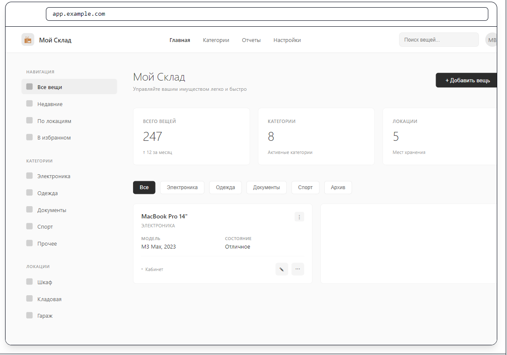
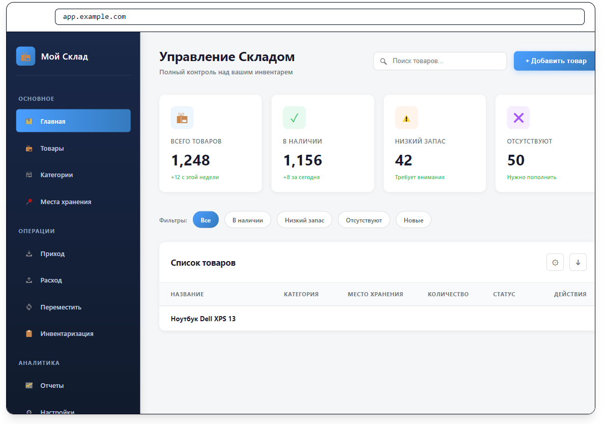
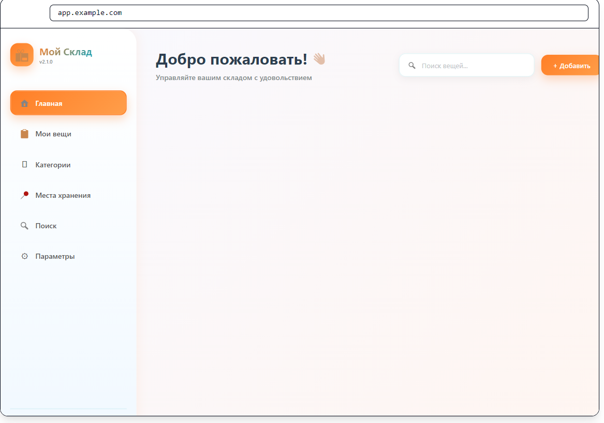

# UI-концепции веб-приложения «Мой Склад»

## Концепция 1. Минималистичная

**Ключевые особенности дизайна:**
- Светлая палитра из холодных серых и белых тонов.
- Тонкий шрифт (light/regular), много свободного пространства.
- Левая боковая панель с навигацией: «Все вещи», «Недавние», «По локациям», «В избранном», категории и локации.
- Верхняя панель с логотипом «Мой Склад», горизонтальным меню («Главная», «Категории», «Отчеты», «Настройки») и строкой поиска.
- Три информационные карточки со статистикой: «Всего вещей» (247), «Категории» (8), «Локации» (5).
- Строка фильтров по категориям («Все», «Электроника», «Одежда», «Документы», «Спорт», «Архив»).
- Карточки вещей с указанием названия, категории, модели, состояния и места хранения.

**Преимущества:**
- Высокая читаемость и «воздух» в интерфейсе.
- Не отвлекает пользователя от данных, акцент на содержимом.
- Легко масштабируется для мобильных устройств.
- Подходит для длительной работы без утомления глаз.

**Недостатки:**
- Может показаться слишком «стерильным» и безликим.
- Низкая эмоциональная вовлеченность пользователя.
- Отсутствуют яркие акценты для важных действий (например, кнопка «Добавить вещь» теряется).

---

## Концепция 2. Корпоративная

**Ключевые особенности дизайна:**
- Темно-синяя боковая панель с белыми иконками и текстом.
- Строгие шрифты без засечек, синие акцентные цвета.
- Заголовок «Управление Складом» с подзаголовком «Полный контроль над вашим инвентарем».
- Четыре информационные карточки с иконками и цветовой индикацией статусов (зеленый — «В наличии», желтый — «Низкий запас», красный — «Отсутствуют»).
- Фильтры в виде «пилюль»: «Все», «В наличии», «Низкий запас», «Отсутствуют», «Новые».
- Табличное представление данных с колонками: «Наименование», «Категория», «Место хранения», «Количество», «Статус», «Действия».

**Преимущества:**
- Профессиональный, деловой вид.
- Удобное табличное представление для работы с большими объемами данных.
- Четкая цветовая индикация статусов (зеленый/желтый/красный).
- Хорошо подходит для корпоративных или складских решений.

**Недостатки:**
- Избыточен для личного приложения — выглядит как «тяжелая» ERP-система.
- Табличный формат плохо адаптируется для мобильных устройств.
- Много визуального шума, сложнее воспринимается новым пользователем.

---

## Концепция 3. Яркая и дружелюбная

**Ключевые особенности дизайна:**
- Теплая палитра: персиковый, оранжевый, светло-бежевый фон.
- Скругленные углы у карточек, иконок и кнопок.
- Приветственный заголовок «Добро пожаловать! ??» с подзаголовком «Управляйте вашим складом с удовольствием».
- Оранжевая кнопка «+ Добавить» — яркий акцент на основном действии.
- Левая боковая панель с выделенным оранжевым пунктом «Главная».
- Логотип «Мой Склад v2.10» с дружелюбной иконкой.

**Преимущества:**
- Дружелюбный и welcoming-эффект, снижает страх перед сложным интерфейсом.
- Яркая кнопка «Добавить» сразу привлекает внимание — снижает количество кликов для основного сценария.
- Отлично подходит для личных приложений и некоммерческих проектов.
- Скругленные элементы создают ощущение мягкости и доступности.

**Недостатки:**
- Менее информативен: на главной странице нет статистики и списка вещей.
- Яркие цвета могут утомлять при длительной работе.
- Оранжевый акцент может плохо сочетаться с некоторыми категориями данных (например, статус «Ошибка»).

---

## Сравнительная таблица концепций

| Критерий | Концепция 1 (Минимализм) | Концепция 2 (Корпоративный) | Концепция 3 (Яркий) |
|---|---|---|---|
| Информативность | 4 | 5 | 3 |
| Читаемость | 5 | 4 | 4 |
| Эмоциональная вовлеченность | 3 | 2 | 5 |
| Подходит для личного приложения | 5 | 2 | 5 |
| Подходит для больших данных | 3 | 5 | 2 |
| Мобильная адаптивность | 5 | 2 | 4 |
| **Средний балл** | **4.2** | 3.3 | 3.8 |

---

## Обоснование выбора

**Выбрана Концепция 1 (Минималистичная).**

**Почему:**

1. **Соответствие целевой аудитории.** Приложение «Мой Склад» ориентировано на частных пользователей, которым важно быстро найти нужную вещь, а не управлять складом на 1000+ позиций. Минимализм лучше подходит для личного использования.

2. **Читаемость и фокус на данных.** Основной сценарий — просмотр списка вещей и поиск. Минималистичный интерфейс не отвлекает и позволяет сконцентрироваться на содержимом.

3. **Мобильная адаптивность.** Минималистичный дизайн с боковой навигацией легко трансформируется в мобильный интерфейс (боковая панель сворачивается в гамбургер-меню).

4. **Расширяемость.** В минималистичный интерфейс легко добавить новые элементы (статистику, графики, фильтры) без потери визуальной целостности.

**Почему не другие концепции:**
- **Концепция 2 (Корпоративная)** — избыточна для личного приложения. Табличный формат неудобен на мобильных устройствах.
- **Концепция 3 (Яркая)** — эмоционально привлекательна, но менее информативна. Отсутствие статистики и списка вещей на главной странице требует дополнительных кликов.

**Итог:** Концепция 1 выбрана как оптимальная по совокупности критериев: она информативна, читаема, адаптивна и соответствует духу личного приложения. Отдельные элементы из Концепции 3 (яркая кнопка «Добавить», приветственный заголовок) могут быть позаимствованы для усиления эмоциональной вовлеченности без потери минимализма.